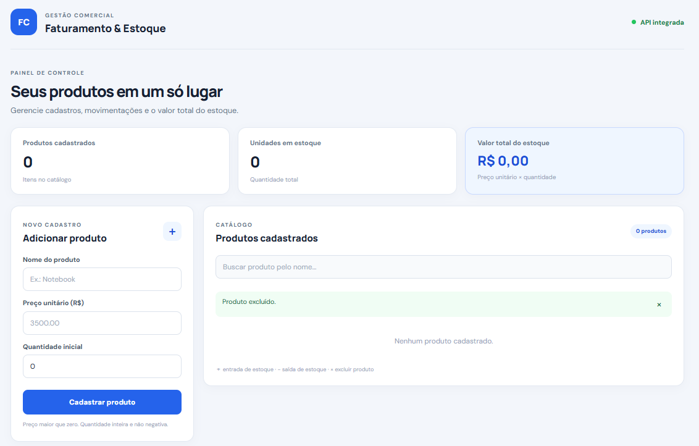
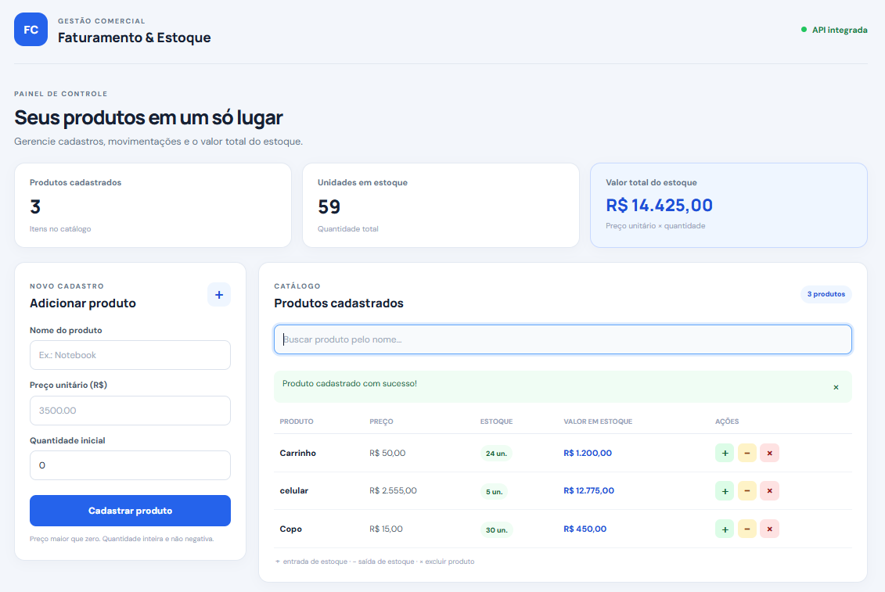

# Sistema de Faturamento Comercial — Cadastro e Controle de Estoque

Aplicação web full stack para cadastro e gerenciamento de produtos, controle de movimentações de estoque e acompanhamento do valor armazenado. O projeto utiliza **Python e Flask** no backend e **React 18 com Webpack** no frontend.

As regras de negócio ficam concentradas no backend, na classe `Produto`, enquanto a interface React consome uma API REST para cadastrar, consultar e movimentar os produtos.

## Funcionalidades

- Cadastro de produtos com nome, preço unitário e quantidade inicial.
- Listagem e pesquisa de produtos pelo nome.
- Exibição da quantidade de tipos de produtos e unidades em estoque.
- Cálculo do valor em estoque por produto (`preço unitário × quantidade`).
- Cálculo do valor total de todo o estoque.
- Entrada e saída de estoque.
- Validação de preço e quantidade.
- Bloqueio de saída quando não há saldo suficiente.
- Atualização e exclusão de produtos.
- Persistência dos dados em arquivo JSON.

## Demonstração visual

### Tela inicial



### Tela de registro e controle de estoque



## Tecnologias utilizadas

### Backend
- Python 3.10 ou superior
- Flask 3.1
- Flask-CORS 5
- API REST
- JSON para persistência local

### Frontend
- React 18
- JavaScript
- Webpack 5 e webpack-dev-server
- Babel
- HTML5 e CSS3

## Estrutura do projeto

```text
Sistema-de-Faturamento-Comercial-Cadastro-e-Controle-de-Estoque/
├── backend/
│   ├── data/                 # dados JSON gerados localmente
│   ├── tests/                # testes automatizados
│   ├── app.py
│   ├── produto.py
│   ├── repositorio.py
│   └── requirements.txt
├── frontend/
│   ├── public/
│   │   └── index.html
│   ├── src/
│   │   ├── App.jsx
│   │   ├── index.jsx
│   │   └── style.css
│   ├── package.json
│   └── webpack.config.js
├── docs/
│   └── screenshots/
├── .github/
│   └── workflows/
└── README.md
```

Pastas geradas localmente, como `backend/.venv/`, `frontend/node_modules/` e `frontend/dist/`, não precisam ser versionadas no Git.

## Pré-requisitos

Instale os seguintes programas:

- [Python 3.10 ou superior](https://www.python.org/downloads/)
- [Node.js LTS](https://nodejs.org/) — a instalação inclui o npm
- [Git](https://git-scm.com/) (opcional, para clonar o repositório)

Confira as instalações no PowerShell:

```powershell
python --version
node -v
npm.cmd -v
```

## Como executar no Windows

O backend e o frontend são iniciados separadamente. Mantenha **dois terminais PowerShell abertos**.

### 1. Clonar o repositório

```powershell
git clone https://github.com/lucasmportela/Sistema-de-Faturamento-Comercial-Cadastro-e-Controle-de-Estoque.git
cd Sistema-de-Faturamento-Comercial-Cadastro-e-Controle-de-Estoque
```

### 2. Preparar e iniciar o backend

No primeiro terminal, entre na pasta `backend`:

```powershell
cd backend
```

Crie o ambiente virtual (se ele ainda não existir):

```powershell
py -m venv .venv
```

Se o comando `py` não estiver disponível, use `python -m venv .venv`.

Instale as dependências:

```powershell
.\.venv\Scripts\python.exe -m pip install -r requirements.txt
```

Inicie a API:

```powershell
.\.venv\Scripts\python.exe app.py
```

O backend ficará disponível em:

- API: `http://127.0.0.1:5000`
- Verificação de funcionamento: `http://127.0.0.1:5000/api/health`

Deixe esse terminal aberto enquanto utilizar o sistema.

### 3. Instalar e iniciar o frontend

Abra um **segundo terminal PowerShell** e entre na pasta `frontend`, a partir da raiz do projeto:

```powershell
cd frontend
```

Instale as dependências do React e do Webpack:

```powershell
npm.cmd install
```

Inicie o servidor de desenvolvimento:

```powershell
npm.cmd start
```

O Webpack está configurado para abrir o navegador automaticamente. A interface ficará disponível em:

**http://localhost:3000**

Deixe também esse terminal aberto enquanto utilizar o sistema.

> **Importante:** este frontend utiliza React com Webpack, não Vite. No PowerShell do Windows, prefira `npm.cmd` em vez de `npm` quando a política de execução bloquear o script `npm.ps1`.

## Como funciona a integração entre frontend e backend

A aplicação utiliza dois servidores durante o desenvolvimento:

| Parte | Endereço | Responsabilidade |
|---|---|---|
| Frontend React + Webpack | `http://localhost:3000` | Interface visual do sistema |
| Backend Flask | `http://127.0.0.1:5000` | API e regras de negócio |

O arquivo `frontend/webpack.config.js` configura o servidor de desenvolvimento na porta **3000** e encaminha as requisições que começam com `/api` para `http://127.0.0.1:5000`. Por isso, o frontend utiliza caminhos relativos, como `/api/produtos`, e não precisa acessar diretamente a porta 5000 pelo navegador.

O backend configura o CORS para aceitar, por padrão, as origens locais `http://localhost:3000` e `http://127.0.0.1:3000`. Se você alterar a porta do frontend ou acessar a API diretamente de outra origem, configure a variável de ambiente `CORS_ORIGINS` antes de iniciar o Flask.

Exemplo no PowerShell para autorizar outro endereço de frontend:

```powershell
$env:CORS_ORIGINS = "http://localhost:8080,http://127.0.0.1:8080"
.\.venv\Scripts\python.exe app.py
```

Use somente origens confiáveis. Com a configuração padrão do Webpack, não é necessário trocar a porta 3000.

## Endpoints da API

| Método | Rota | Descrição |
|---|---|---|
| `GET` | `/api/health` | Verifica se a API está ativa |
| `GET` | `/api/produtos` | Lista os produtos e o valor total do estoque |
| `POST` | `/api/produtos` | Cadastra um produto |
| `PUT` | `/api/produtos/<id>` | Atualiza os dados de um produto |
| `DELETE` | `/api/produtos/<id>` | Exclui um produto |
| `POST` | `/api/produtos/<id>/estoque/adicionar` | Registra entrada de estoque |
| `POST` | `/api/produtos/<id>/estoque/remover` | Registra saída de estoque |

### Exemplo: cadastrar produto

`POST /api/produtos`

```json
{
  "nome": "Notebook",
  "preco": 3500.00,
  "quantidade": 10
}
```

### Exemplo: adicionar estoque

`POST /api/produtos/1/estoque/adicionar`

```json
{
  "quantidade": 5
}
```

### Exemplo: remover estoque

`POST /api/produtos/1/estoque/remover`

```json
{
  "quantidade": 3
}
```

A rota `GET /api/produtos` retorna a lista de produtos e o valor total do estoque em formato JSON.

## Regras de negócio

- O nome do produto é obrigatório.
- O preço deve ser um número maior que zero.
- A quantidade inicial deve ser um número inteiro não negativo.
- Entradas e saídas de estoque devem utilizar quantidades inteiras maiores que zero.
- A saída não pode ultrapassar a quantidade disponível.
- O valor em estoque de cada produto é calculado por `preço × quantidade`.
- O valor total do estoque corresponde à soma dos valores em estoque de todos os produtos.

A classe `Produto` aplica as validações por meio de propriedades (`@property` e `@setter`) e métodos de movimentação de estoque.

## Persistência dos dados

Os produtos são armazenados localmente em:

```text
backend/data/produtos.json
```

O arquivo é criado automaticamente pelo repositório caso ainda não exista. Mantenha esse arquivo para preservar os cadastros locais e faça cópias de segurança antes de alterações manuais. Os dados de execução local não devem ser confundidos com os arquivos versionados no Git.

## Testes e integração contínua

O projeto utiliza `unittest` para executar os testes automatizados do backend. Na raiz do repositório, execute:

```powershell
.\\backend\\.venv\\Scripts\\python.exe -m unittest discover -s backend/tests -v
```

O workflow `.github/workflows/ci.yml` é executado em pushes e pull requests direcionados à branch `main`. Ele:

- instala as dependências Python;
- verifica a sintaxe do backend com `python -m compileall -q backend`;
- executa os testes com `python -m unittest discover -s backend/tests -v`;
- instala as dependências do frontend e executa o build de produção com `npm run build`.

## Gerar a versão de produção do frontend

Na pasta `frontend`, execute:

```powershell
npm.cmd run build
```

Os arquivos otimizados serão gerados em `frontend/dist/`. Essa etapa gera os arquivos do frontend; ela não inicia o backend Flask.

## Solução de problemas

### O endereço `http://127.0.0.1:5000/` mostra 404

Esse comportamento é esperado: o Flask disponibiliza endpoints da API e não possui uma página inicial na rota `/`. Para verificar o backend, acesse:

`http://127.0.0.1:5000/api/health`

Para abrir a interface visual, inicie os dois servidores e acesse **http://localhost:3000**.

### O comando `npm.cmd` não é reconhecido

Verifique se o Node.js e o npm estão instalados:

```powershell
node -v
where.exe node
where.exe npm
```

Se o Node.js não estiver instalado, instale a versão LTS pelo [site oficial](https://nodejs.org/). Se acabou de instalar, feche e abra novamente o PowerShell para atualizar o PATH do Windows. Se `node -v` funcionar, mas `npm.cmd` não for encontrado, confira se a pasta de instalação do Node.js está no PATH.

### O navegador não consegue se conectar à API

- Confirme se o backend está ativo no primeiro terminal.
- Confirme se o frontend está ativo no segundo terminal.
- Teste `http://127.0.0.1:5000/api/health`.
- Confira se o proxy `/api` do `frontend/webpack.config.js` aponta para `http://127.0.0.1:5000`.
- Se alterou a porta ou removeu o proxy, revise a variável `CORS_ORIGINS` no backend.

## Conceitos praticados

- Classes e objetos.
- Encapsulamento e atributos protegidos.
- Decoradores `@property` e `@setter`.
- Validação e tratamento de erros.
- Métodos de instância.
- Criação de API REST.
- Integração entre frontend e backend.
- Persistência de dados em JSON.
- Testes automatizados e integração contínua.

## Autor

Projeto desenvolvido para fins de estudo em Python, Programação Orientada a Objetos e desenvolvimento Full Stack.
